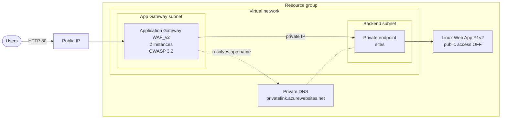

# Application Gateway + WAF in Front of a Private Web App (Terraform)

A focused lab on one pattern: the web app has public network access switched
off completely, and the only way in is through an Azure Application Gateway
with a Web Application Firewall. The gateway reaches the app over a private
endpoint.

The pattern is reused in [PROJ_003](https://github.com/Cloud-n-devops/PROJ_003_AZ_ZERO_TRUST),
which combines it with a full Laravel stack.

## Architecture



## How it works

1. A request arrives at the gateway's public IP.
2. The WAF policy inspects it against the OWASP 3.2 managed rule set.
3. The gateway forwards it to the app's hostname. The private DNS zone
   `privatelink.azurewebsites.net` makes that hostname resolve to the private
   endpoint's IP inside the VNet, so the traffic never leaves the private
   network.
4. The app has `public_network_access_enabled = false`. Hitting its
   `*.azurewebsites.net` address from the internet returns 403.

The gateway sends the app's own hostname to the backend
(`pick_host_name_from_backend_address`), which App Service needs to route the
request to the right site.

## Modules

| Module | What it creates |
| --- | --- |
| `networking` | VNet, gateway subnet, backend subnet, public IP, private DNS zone with VNet link and A record |
| `compute` | P1v2 Linux plan (needed for Private Link), web app with public access off, autoscale |
| `security` | Application Gateway WAF_v2 and the WAF policy |
| root | Resource group and the private endpoint for the web app |

## Deploying

```bash
az login
cp credentials.example.tf credentials.tf   # git-ignored
terraform init
terraform plan -out tfplan
terraform apply tfplan
```

Open the gateway's public IP in a browser to reach the app. Then try the app's
`azurewebsites.net` address directly: it should be blocked.

Destroy when done; Application Gateway WAF_v2 is the most expensive part:

```bash
terraform destroy
```

## Known gaps

- The WAF runs in **Detection** mode, which logs attacks without blocking
  them. This is the normal first step while checking for false positives;
  PROJ_003 switches to Prevention.
- The listener is HTTP only. PROJ_003 adds HTTPS with a certificate from Key
  Vault and an HTTP-to-HTTPS redirect.
- Terraform state is local.
